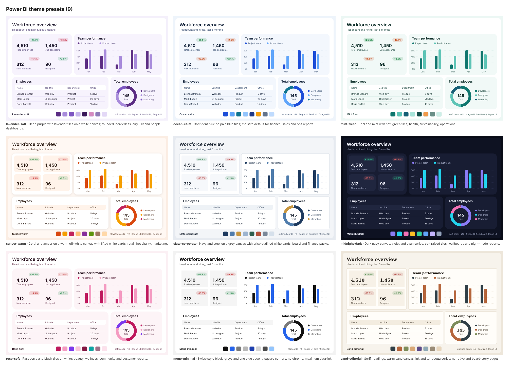
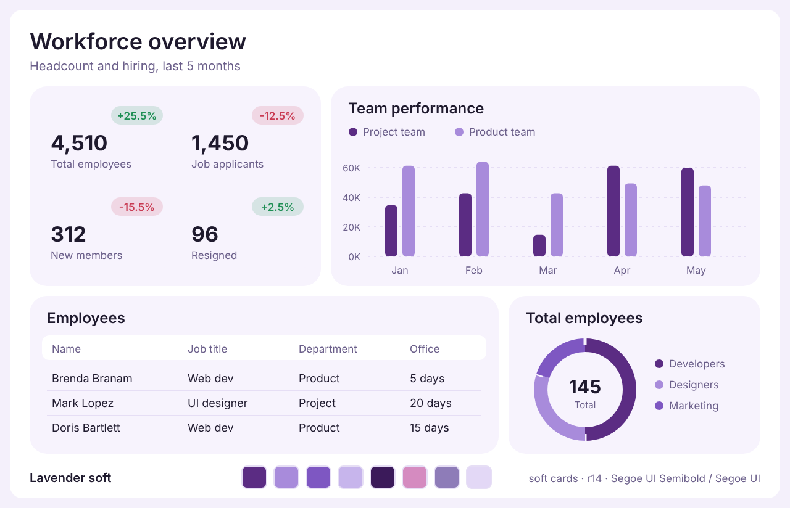
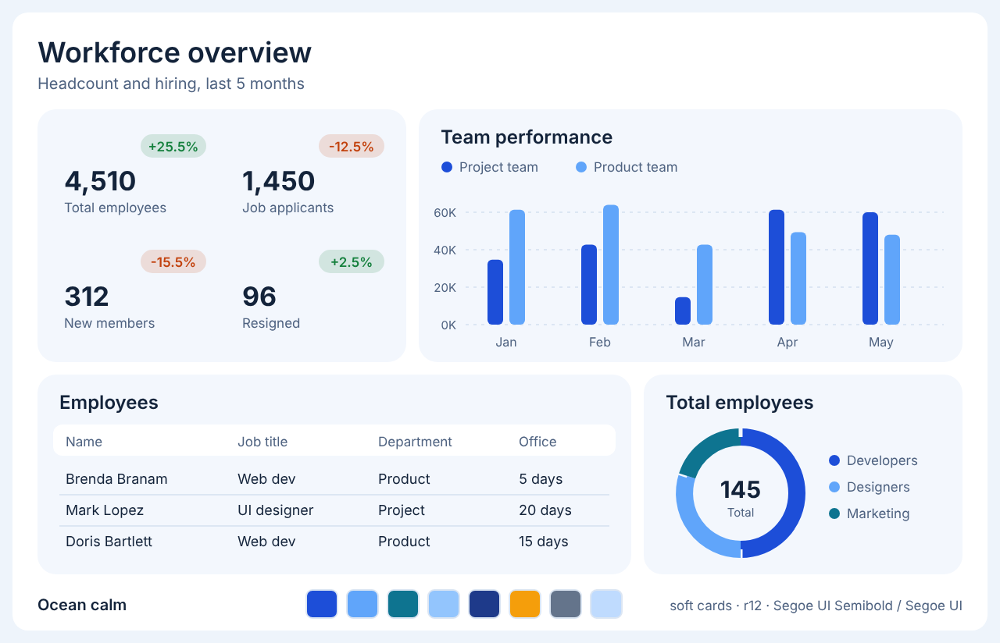
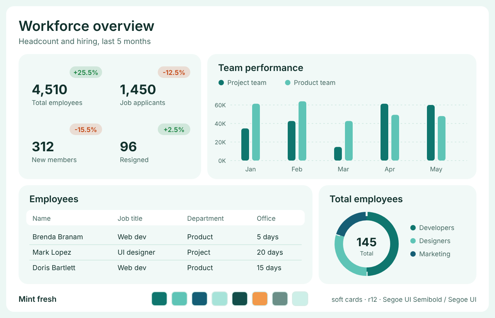
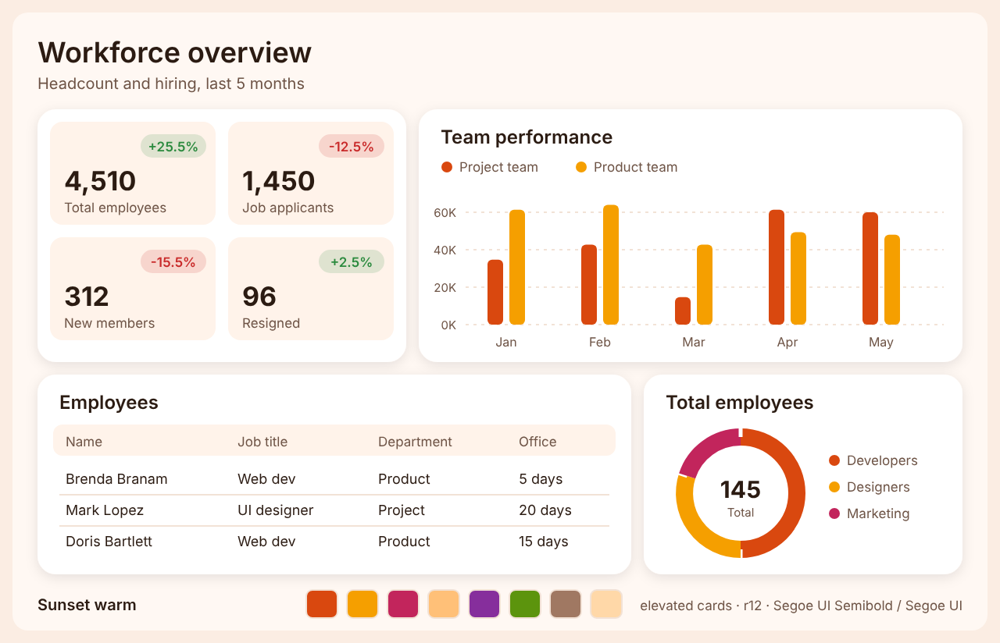
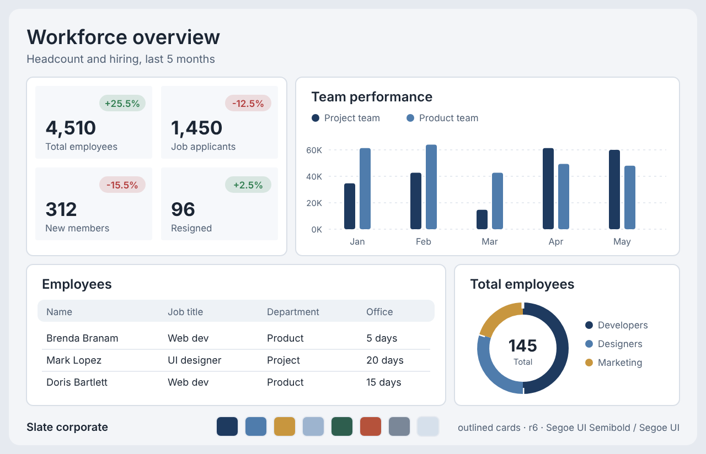
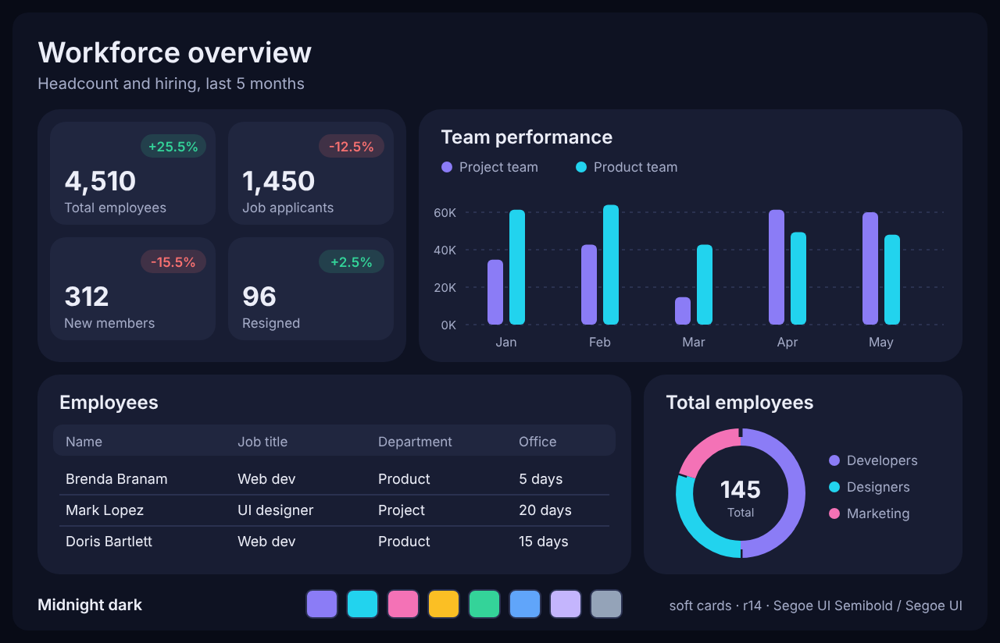
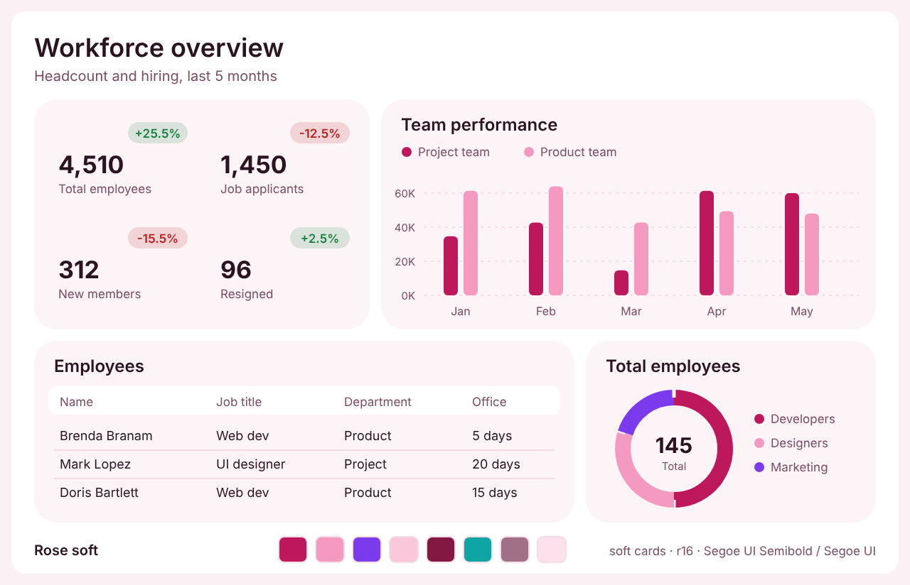
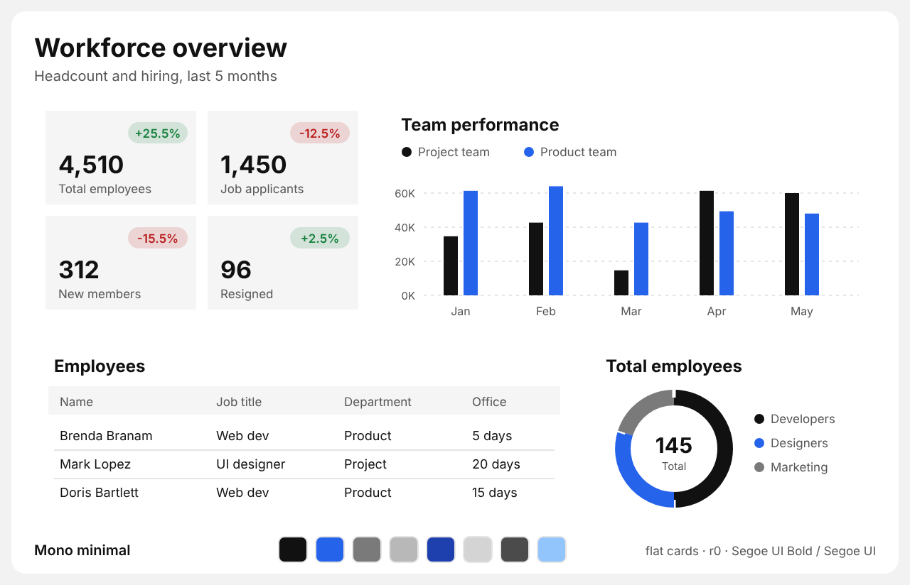
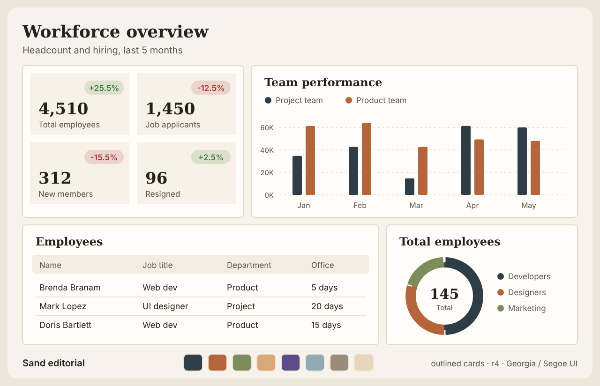

# Theme preset catalog

<!-- Generated by scripts/build_theme.py --build-assets. Edit PRESETS there, not this file. -->

9 presets. Default when the user names none and has no brand or design to match: **`ocean-calm`**. Each preview is a mock page rendered from the preset's tokens (Inter stands in for Segoe UI in the images). Ready-to-register theme files are in `assets/themes/`.

| Preset | Mode | Cards | Radius | Fonts | Use for |
|---|---|---|---|---|---|
| [`lavender-soft`](#lavender-soft) | light | soft | 14 | Segoe UI Semibold / Segoe UI | Deep purple with lavender tiles on a white canvas; rounded, borderless, airy. HR and people dashboards. |
| [`ocean-calm`](#ocean-calm) | light | soft | 12 | Segoe UI Semibold / Segoe UI | Confident blue on pale blue tiles; the safe default for finance, sales and ops reports. |
| [`mint-fresh`](#mint-fresh) | light | soft | 12 | Segoe UI Semibold / Segoe UI | Teal and mint with soft green tiles; health, sustainability, operations. |
| [`sunset-warm`](#sunset-warm) | light | elevated | 12 | Segoe UI Semibold / Segoe UI | Coral and amber on a warm off-white canvas with lifted white cards; retail, hospitality, marketing. |
| [`slate-corporate`](#slate-corporate) | light | outlined | 6 | Segoe UI Semibold / Segoe UI | Navy and steel on a grey canvas with crisp outlined white cards; board and finance packs. |
| [`midnight-dark`](#midnight-dark) | dark | soft | 14 | Segoe UI Semibold / Segoe UI | Dark navy canvas, violet and cyan series, soft raised tiles; wallboards and night-mode reports. |
| [`rose-soft`](#rose-soft) | light | soft | 16 | Segoe UI Semibold / Segoe UI | Raspberry and blush tiles on white; beauty, wellness, community and customer reports. |
| [`mono-minimal`](#mono-minimal) | light | flat | 0 | Segoe UI Bold / Segoe UI | Swiss-style black, greys and one blue accent; square corners, no chrome, maximum data-ink. |
| [`sand-editorial`](#sand-editorial) | light | outlined | 4 | Georgia / Segoe UI | Serif headings, warm sand canvas, ink and terracotta series; narrative and board-story pages. |

## lavender-soft

Deep purple with lavender tiles on a white canvas; rounded, borderless, airy. HR and people dashboards.

- Theme file: `assets/themes/LavenderSoft.json`
- Canvas `#FFFFFF`, visuals `#F7F3FD`, KPI tiles `#F7F3FD`, border none, text `#1F1A2E`, labels `#6B5F8A`
- Series: `#5B2C83` `#A88BDB` `#7E57C2` `#C7B5EC` `#3B1A5A` `#D58BC0` `#8E7CB8` `#E3D8F6`
- Lowest text contrast 5.3:1; below 3:1 for graphics: series 2 on visual

## ocean-calm

Confident blue on pale blue tiles; the safe default for finance, sales and ops reports.

- Theme file: `assets/themes/OceanCalm.json`
- Canvas `#FFFFFF`, visuals `#F3F7FD`, KPI tiles `#F3F7FD`, border none, text `#13233A`, labels `#4E6280`
- Series: `#1D4ED8` `#60A5FA` `#0E7490` `#93C5FD` `#1E3A8A` `#F59E0B` `#64748B` `#BFDBFE`
- Lowest text contrast 5.8:1; below 3:1 for graphics: series 2 on visual

## mint-fresh

Teal and mint with soft green tiles; health, sustainability, operations.

- Theme file: `assets/themes/MintFresh.json`
- Canvas `#FFFFFF`, visuals `#F1F9F7`, KPI tiles `#F1F9F7`, border none, text `#10302B`, labels `#466A63`
- Series: `#0F766E` `#5EC4B6` `#155E75` `#A7E3D9` `#134E4A` `#F2994A` `#6B8F88` `#CDEFE8`
- Lowest text contrast 5.6:1; below 3:1 for graphics: series 2 on visual

## sunset-warm

Coral and amber on a warm off-white canvas with lifted white cards; retail, hospitality, marketing.

- Theme file: `assets/themes/SunsetWarm.json`
- Canvas `#FFF8F3`, visuals `#FFFFFF`, KPI tiles `#FFF3EA`, border none, text `#2B1B12`, labels `#6E5446`
- Series: `#D9480F` `#F59F00` `#C2255C` `#FFC078` `#862E9C` `#5C940D` `#A07862` `#FFD8A8`
- Lowest text contrast 6.4:1; below 3:1 for graphics: series 2 on visual

## slate-corporate

Navy and steel on a grey canvas with crisp outlined white cards; board and finance packs.

- Theme file: `assets/themes/SlateCorporate.json`
- Canvas `#F3F5F8`, visuals `#FFFFFF`, KPI tiles `#F6F8FB`, border `#D9DFE7`, text `#1B2533`, labels `#516074`
- Series: `#1E3A5F` `#4F7CAC` `#C8963E` `#9DB4CF` `#2E5E4E` `#B5523B` `#7A8798` `#D6E0EB`
- Lowest text contrast 5.7:1

## midnight-dark

Dark navy canvas, violet and cyan series, soft raised tiles; wallboards and night-mode reports.

- Theme file: `assets/themes/MidnightDark.json`
- Canvas `#0E1222`, visuals `#181D33`, KPI tiles `#20263F`, border none, text `#ECEEF8`, labels `#A5ACC8`
- Series: `#8B7CF6` `#22D3EE` `#F472B6` `#FBBF24` `#34D399` `#60A5FA` `#C4B5FD` `#94A3B8`
- Lowest text contrast 6.6:1

## rose-soft

Raspberry and blush tiles on white; beauty, wellness, community and customer reports.

- Theme file: `assets/themes/RoseSoft.json`
- Canvas `#FFFFFF`, visuals `#FDF4F7`, KPI tiles `#FDF4F7`, border none, text `#2A1420`, labels `#7A4D62`
- Series: `#BE185D` `#F49AC1` `#7C3AED` `#F9C6DA` `#831843` `#0EA5A4` `#A07088` `#FCE1EC`
- Lowest text contrast 6.3:1; below 3:1 for graphics: series 2 on visual

## mono-minimal

Swiss-style black, greys and one blue accent; square corners, no chrome, maximum data-ink.

- Theme file: `assets/themes/MonoMinimal.json`
- Canvas `#FFFFFF`, visuals `#FFFFFF`, KPI tiles `#F5F5F5`, border none, text `#111111`, labels `#555555`
- Series: `#111111` `#2563EB` `#7A7A7A` `#B8B8B8` `#1E40AF` `#D4D4D4` `#4B4B4B` `#93C5FD`
- Lowest text contrast 6.8:1

## sand-editorial

Serif headings, warm sand canvas, ink and terracotta series; narrative and board-story pages.

- Theme file: `assets/themes/SandEditorial.json`
- Canvas `#F7F3EC`, visuals `#FFFDF9`, KPI tiles `#F7F1E7`, border `#E3D9C8`, text `#26211B`, labels `#5F564A`
- Series: `#2F3E46` `#B5653B` `#7C8C5A` `#D9A877` `#5B4B8A` `#8FA9B5` `#9A8C78` `#E8D5BC`
- Lowest text contrast 6.1:1
